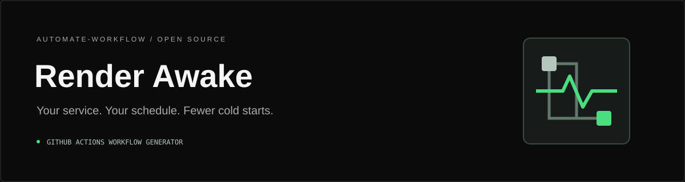

# Render Awake

A browser-based GitHub Actions workflow generator for scheduled HTTPS requests to eligible Render web services. Configure an endpoint and schedule, review the YAML, and add it to your repository.

**[Launch Render Awake](https://automate-workflow.github.io/render-awake/)**

[Repository](https://github.com/Automate-Workflow/render-awake) · [Issues](https://github.com/Automate-Workflow/render-awake/issues) · [Apache-2.0 license](./LICENSE)

No backend, package installation, or Render Awake authentication is required. GitHub handles its own sign-in and repository permissions. The GitHub handoff is manual: you paste the YAML and create the pull request yourself.

## Why Render Awake?

Eligible Render free web services spin down after inactivity. Scheduled health-check requests can help reduce idle periods during development or demos. Render Awake turns a few configuration choices into a readable GitHub Actions workflow, without requiring you to write cron expressions or shell commands.

Scheduled pings do not guarantee uptime or bypass platform restrictions. Delayed runs, deployments, outages, and exhausted instance-hour allowances can still interrupt availability. Review [Render’s free-service limits](https://render.com/docs/free) before enabling a schedule.

## Features

- Accepts `owner/repo` or a GitHub repository URL, including trailing slashes and `.git` suffixes.
- Validates repository names, target branches, and HTTPS service URLs.
- Tests endpoints in the browser with a timeout and CORS-aware feedback.
- Generates 10-, 12-, or 14-minute cron steps with optional daily active windows.
- Supports UTC and IST (`Asia/Kolkata`) for limited active windows.
- Updates a highlighted YAML preview immediately as configuration changes.
- Copies or downloads exact workflow YAML, with a manual clipboard fallback.
- Opens GitHub’s new-file editor with the intended workflow filename.

## How it works

```text
Configure service
       |
Generate workflow
       |
Copy YAML + Open GitHub
       |
Paste and commit on a new branch
       |
Create pull request
       |
Merge to default branch
       |
GitHub Actions schedules HTTP requests
```

## Getting started

### 1. Open Render Awake

Visit **[Render Awake](https://automate-workflow.github.io/render-awake/)**. Have your repository name and a public HTTPS health-check endpoint ready.

### 2. Configure the workflow

| Field | Example | Behavior |
| --- | --- | --- |
| GitHub Repository | `ayushcmd/fitoglobe` | Also accepts `https://github.com/owner/repo`; normalizes to `owner/repo`. |
| Target Branch | `main` | Defaults to `main`; use an existing branch in the target repository. |
| Render Service URL | `https://your-app.onrender.com/health` | Requires HTTPS; rejects embedded credentials, fragments, and unsafe characters. |
| Ping Interval | Every 10 minutes | Recommended default; 12 and 14 minutes are also available. |
| Active Hours | Always Awake — 24 hours/day | Default; choose Extended Day or Work Hours to reveal the window controls. |
| Start hour | `08:00` | Defaults to `08:00` for limited windows; selectable in whole hours. |
| Timezone | IST (Asia/Kolkata) | Visible for limited windows; defaults to UTC. All-day schedules use UTC. |

The example repository and service URL above are illustrative; replace them with your own. Custom HTTPS domains are accepted, not only `onrender.com` addresses. Use an endpoint intended for public health checks, without tokens or other secrets.

**Test Endpoint** is optional. It attempts a request from your browser for up to 15 seconds. CORS restrictions can block this test even when GitHub Actions can reach the endpoint.

The branch field selects where GitHub opens its editor. Scheduled workflows execute from the repository’s **actual default branch**, so merge the finished workflow there even if you create it on another branch. Input validation does not check whether a repository or branch exists or whether you have access.

### 3. Review generated YAML

The preview updates automatically. A **Ready** indicator enables the export actions when the required inputs are valid; it does not confirm endpoint availability or repository access.

The generated workflow is named **Keep Render Service Awake**:

- `schedule` defines recurring runs; `workflow_dispatch` enables manual runs.
- A job runs on `ubuntu-latest` with a two-minute job timeout and read-only contents permission.
- `curl` follows HTTPS redirects, uses a 15-second connection timeout and a 60-second total request timeout, and passes the URL through a quoted environment-variable reference.
- Network failures and final HTTP responses other than **200** fail the job. Logs report request failure or the HTTP status.

Review the endpoint and schedule before committing. The generated file contains your endpoint URL.

### 4. Open GitHub

Select **Open on GitHub**. The app copies the generated YAML and opens GitHub’s new-file editor, using the `filename` query parameter to attempt to prefill:

```text
.github/workflows/render-awake.yml
```

**It does not automatically paste the YAML, commit a file, or create a pull request.** A blank tab may appear briefly while clipboard access completes.

If clipboard access fails, copy the selected YAML from the displayed text area with Ctrl+C or Command+C. If a new tab is blocked, use **Continue to GitHub**. Sign in on GitHub when prompted.

### 5. Paste and create the pull request

1. Paste the copied YAML into GitHub’s editor.
2. Confirm the full filename is `.github/workflows/render-awake.yml`; enter it manually if it was not prefilled. If that file already exists, edit it instead of adding a duplicate.
3. Select **Commit changes** and enter a message, such as `chore(ci): add Render keep-alive workflow`.
4. Choose the option to create a **new branch** and start a pull request; give the branch a descriptive name.
5. Create the pull request and review its changes.
6. Merge the pull request into the repository’s default branch when approved.

Appropriate GitHub permissions are required. Without write access, you may need to fork the repository and propose the change from your fork. Branch protections and organization policies can require review or additional permissions. See [GitHub’s file-creation guide](https://docs.github.com/en/repositories/working-with-files/managing-files/creating-new-files).

### 6. Verify the workflow

Open your repository’s **Actions** tab and select **Keep Render Service Awake**. After the file is on the default branch, users with the necessary permissions can select **Run workflow** to test it manually.

Open a run, select the **keep-awake** job, and expand **Ping Render service** to inspect the HTTP status or failure message. A successful manual run confirms that request worked at that time; it does not guarantee future scheduled runs. See [manually running a workflow](https://docs.github.com/en/actions/how-tos/manage-workflow-runs/manually-run-a-workflow).

### Copy or download instead

**Copy YAML** copies the generated content without opening GitHub. **Download YAML** saves a UTF-8 `render-awake.yml`; place it inside `.github/workflows/` in your repository, commit on a new branch, and open a pull request. Both actions require valid configuration. No package installation is needed.

## Schedule configuration

| Setting | Generated behavior |
| --- | --- |
| Every 10 minutes | `*/10`: minutes 0, 10, 20, 30, 40, 50 of each active hour; recommended default. |
| Every 12 minutes | `*/12`: minutes 0, 12, 24, 36, 48 of each active hour. |
| Every 14 minutes | `*/14`: minutes 0, 14, 28, 42, 56 of each active hour. |
| Always Awake — 24 hours/day | Every hour, every day, in UTC. |
| Extended Day — 16 hours/day | A daily 16-hour window from the selected start hour. |
| Work Hours — 12 hours/day | A daily 12-hour window, including weekends. |
| UTC | Cron uses the `UTC` timezone. |
| IST | Cron uses the IANA timezone `Asia/Kolkata`. |

Cron steps restart each hour: the 14-minute option has a four-minute gap between minute 56 and minute 0 of the next hour. It is not a continuous 14-minute timer.

Limited windows include the start hour and exclude the ending hour. For example, Work Hours starting at `08:00` schedules requests from 08:00 through 19:59. Starting at `20:00` produces two cron entries covering 20:00–23:59 and 00:00–07:59. The generator uses GitHub’s supported [`timezone` field](https://docs.github.com/en/actions/reference/workflows-and-actions/workflow-syntax#onschedule), without manually converting IST into UTC.

GitHub scheduling is best-effort: jobs may be delayed or dropped under load. Public-repository schedules can be disabled after 60 days without repository activity. The workflow must be on the default branch, Actions must be enabled, and applicable usage limits and policies still apply. See [GitHub’s schedule documentation](https://docs.github.com/en/actions/reference/workflows-and-actions/events-that-trigger-workflows#schedule).

Active hours constrain scheduled trigger times, not actual execution times. A delayed job or manual run can execute outside the window. Normal traffic can also wake the service outside it.

## Render’s free-instance-hour allowance

Render currently describes a **750 free-instance-hour allowance per workspace per calendar month**, shared by its free web services. Each running service draws from that same allowance; it is not 750 hours per service. Spun-down services do not consume instance hours.

Free web services spin down after 15 minutes without inbound traffic. Pings can keep services running longer and increase usage. Continuously pinging several services can exhaust the shared allowance; Render then suspends free web services until the next month unless they are upgraded. Check workspace usage in Render’s dashboard.

Terms and limits may change. [Render’s official free-service documentation](https://render.com/docs/free) is authoritative. This generator does not calculate allowances or guarantee availability.

## Troubleshooting

| Problem | What to do |
| --- | --- |
| GitHub’s editor opens without YAML | This is expected. Paste the copied YAML; if copying failed, use the app’s selected text area. |
| GitHub does not prefill the filename | Enter `.github/workflows/render-awake.yml` manually. |
| Clipboard access or a new tab is blocked | Copy from the manual text area or use Download YAML; use Continue to GitHub for the editor. |
| Workflow does not appear in Actions | Confirm the file is valid YAML under `.github/workflows/`, merge it into the default branch, and check that Actions is enabled. |
| Scheduled workflow does not run | Check the default branch, active window and timezone, workflow enablement, repository policies, and Actions usage limits. Allow for delays; try Run workflow to diagnose the request separately. |
| Health endpoint returns a non-200 response | Inspect the run’s HTTP status and service logs. Use a public endpoint that returns 200; other success codes such as 204 still fail this workflow. |
| Browser endpoint test fails or reports CORS | The browser cannot confirm availability. Check a manual Actions run; browser CORS does not apply to the runner’s curl request. |
| Workflow exists but the service still sleeps | Inspect recent run timestamps and failures. Scheduled runs can be delayed or dropped; also check deployments, outages, and the chosen active window. |
| Request times out | Check service logs and cold-start behavior. The generated request stops after 60 seconds; a later manual run can distinguish a temporary startup delay from a persistent failure. |
| Monthly Render allowance is exhausted | Check workspace usage; wait for renewal or choose an appropriate paid instance. Pings do not restore exhausted hours. |
| A workflow file already exists | Edit the existing file through a branch and pull request. Avoid duplicate schedules. |

## Disable or remove the workflow

To pause requests, open **Actions → Keep Render Service Awake → … → Disable workflow**. You can re-enable it later. See [disabling and enabling workflows](https://docs.github.com/en/actions/how-tos/manage-workflow-runs/disable-and-enable-workflows).

To remove it, delete `.github/workflows/render-awake.yml`, commit the removal, and merge it into the default branch if using a pull request. Disabling or deleting this workflow does not stop normal traffic from reaching your service.

## Local development

The production app uses static HTML, CSS, and JavaScript with no dependencies or build step. For local development, use Python 3 to serve ES modules over HTTP:

```sh
git clone https://github.com/Automate-Workflow/render-awake.git
cd render-awake
python -m http.server 8000 --bind 127.0.0.1
```

Open [localhost:8000](http://localhost:8000). Run the existing tests with Node.js 22.7+ from the repository root:

```sh
node --test tests/*.test.mjs
```

Node is only a development/testing convenience. Tests cover validation, schedule combinations, YAML generation, GitHub URL construction, and browser-handler behavior through a small test harness. See [CONTRIBUTING.md](./CONTRIBUTING.md) for contribution procedures.

GitHub Pages serves the project from `main` at `/ (root)` using **Deploy from a branch**. All app assets use relative paths; no build workflow is needed.

## Project structure

```text
render-awake/
├── README.md                         Usage and troubleshooting
├── CONTRIBUTING.md                   Contribution guide
├── SECURITY.md                       Private vulnerability reporting
├── CODE_OF_CONDUCT.md                 Community expectations
├── LICENSE                           Canonical Apache-2.0 terms
├── NOTICE                            Project attribution
├── .github/
│   ├── ISSUE_TEMPLATE/
│   │   ├── bug_report.yml            Bug report form
│   │   ├── feature_request.yml       Feature request form
│   │   └── config.yml                Issue chooser and security contact
│   └── pull_request_template.md      Review context and checklist
├── index.html                        Accessible application structure
├── css/styles.css                    Responsive dark interface
├── js/
│   ├── cron-math.js                  Validation, schedules, and YAML
│   └── app.js                        Browser interactions
├── assets/
│   ├── logo.svg                      Original workflow mark
│   └── banner.svg                    README banner
└── tests/generator.test.mjs          Node built-in test suite
```

## Community and security

Contributions are welcome. Read [CONTRIBUTING.md](./CONTRIBUTING.md) and follow the [Code of Conduct](./CODE_OF_CONDUCT.md). For suspected vulnerabilities, follow [SECURITY.md](./SECURITY.md) instead of opening a public issue.

## License and maintainer

Copyright 2026 Ayush Raj and Automate-Workflow. Licensed under [Apache License 2.0](./LICENSE); see [NOTICE](./NOTICE) for attribution.

Maintained by **Ayush Raj**: [GitHub](https://github.com/ayushcmd) · [LinkedIn](https://www.linkedin.com/in/ayushcmd) · [Email](mailto:ayush_24a12res897@iitp.ac.in).

Organization: [Automate-Workflow](https://github.com/Automate-Workflow).

Render Awake is an independent project, not affiliated with or endorsed by Render or GitHub.
